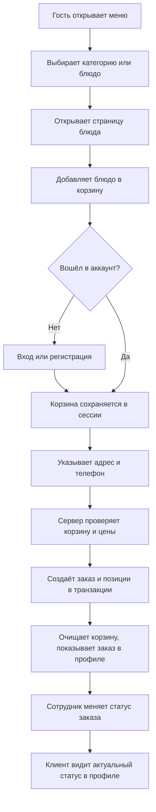
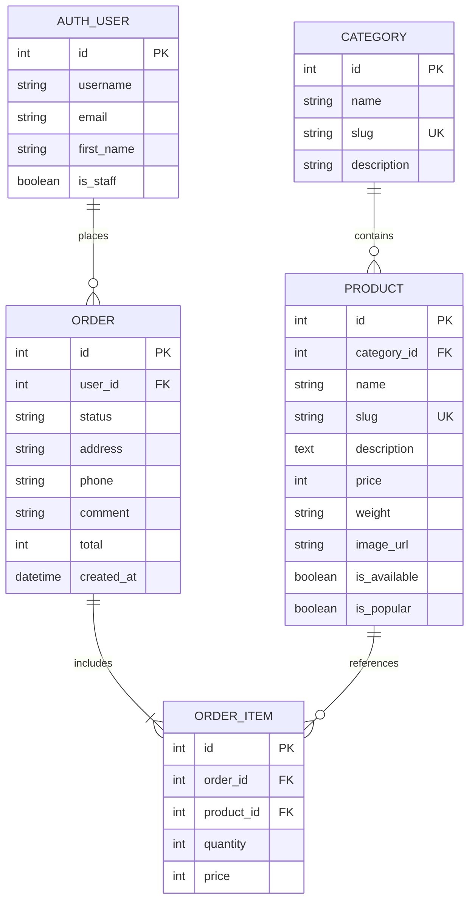

# Тарелка — сервис доставки еды

Учебный проект на Django: главная страница, каталог с фильтром категорий, карточка блюда, регистрация и вход, профиль с историей заказов, корзина/оформление и панель управления заказами. Django Admin доступна по адресу `/admin/`.

## Запуск

```powershell
py -m venv .venv
.\.venv\Scripts\Activate.ps1
pip install -r requirements.txt
py manage.py migrate
py manage.py createsuperuser
py manage.py runserver
```

После первой миграции в меню автоматически появятся демонстрационные блюда и категории. Добавляйте и редактируйте их через `/admin/`. Чтобы открыть панель заказов `/dashboard/`, администратор должен иметь флаг «Статус персонала».

## Страницы и возможности

| Страница | URL | Доступ |
|---|---|---|
| Главная | `/` | Всем |
| Вход | `/login/` | Всем |
| Регистрация | `/register/` | Гостям |
| Каталог и фильтр категорий | `/menu/` | Всем |
| Детали блюда | `/menu/<slug>/` | Всем |
| Корзина и оформление | `/checkout/` | Оформление — после входа |
| Профиль и заказы | `/profile/` | Авторизованным |
| Управление заказами | `/dashboard/` | Персоналу |
| Админка Django | `/admin/` | Суперпользователям |

Корзина хранится в сессии. Стоимость и количество блюд фиксируются в заказе при оформлении. Для локальной разработки используется SQLite.

## Схема бизнес-логики



## ER-диаграмма


